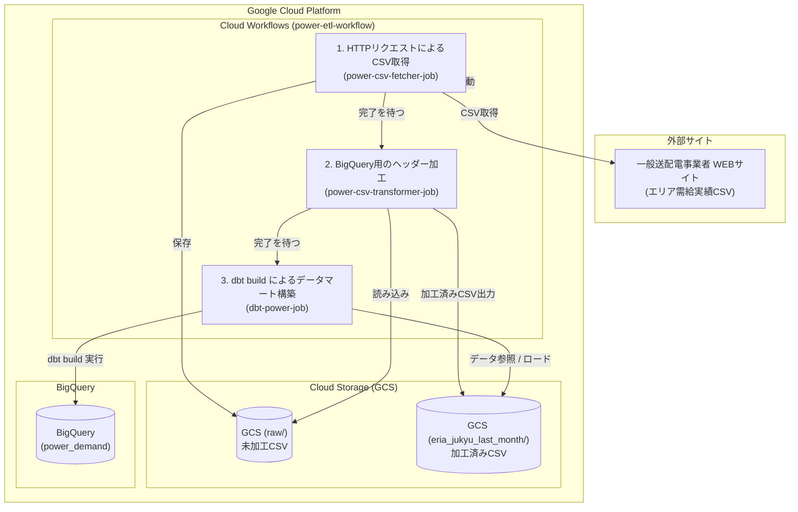

# Google Cloud（Workflows / Cloud Run Jobs / dbt / BigQuery）を活用したサーバーレスデータパイプライン

本ドキュメントでは、Cloud Workflows を用いたデータパイプライン（power-csv-fetcher-job、power-csv-transformer-job、および dbt-power-job による BigQuery データマート構築の逐次実行）の構築手順とデプロイ方法について説明します

## 💡 アーキテクチャの設計思想 (ELT)

1. **E (Extract / 抽出)**
   * **担当**: `power-csv-fetcher-job`
   * **内容**: 外部Webサイトから最新のエリア需給実績CSVデータをそのまま抽出します。

2. **L (Load / ロード)**
   * **担当**: GCS ＆ BigQuery 外部テーブル
   * **内容**: 抽出・加工したCSVファイルを Cloud Storage (GCS) に配置し、BigQuery から **外部テーブル（External Table）として直接参照できるようにロード（結びつけ）** します。データを物理的に二重持ちせず、ストレージ（GCS）をそのままDWHからクエリできる状態にします。

3. **T (Transform / 変換・モデリング)**
   * **担当**: `dbt-power-job`（BigQuery × dbt）
   * **内容**: BigQueryの計算パワーを活かし、外部テーブルとしてロードされたデータを `dbt (dbt build)` でクレンジング・結合・集計し、分析用のデータマート（`marts/`）を構築します。
---
## 処理フロー図


## 1. 事前準備 (IAM 権限の設定)

Cloud Workflows から Cloud Run Jobs (`power-csv-fetcher-job`, `power-csv-transformer-job`) を実行するため、専用のサービスアカウントを作成し、必要なロールを付与します。

### サービスアカウント名
`power-fetcher-sa@<PROJECT_ID>.iam.gserviceaccount.com`

### 付与する IAM ロール
ワークフローの実行用サービスアカウントには、以下のロールを付与します。

1. **Cloud Run 閲覧者** (`roles/run.viewer`)
   - ジョブの実行結果・ステータスを取得するために必要
2. **Cloud Run 起動元** (`roles/run.invoker`)
   - Cloud Run Jobs の実行（トリガー）に必要
3. **ログ書き込み** (`roles/logging.logWriter`)
   - ワークフローの実行ログを Cloud Logging へ書き込むために必要
4. **ワークフロー起動元** (`roles/workflows.invoker`)
   - ワークフローの実行・管理に必要

> **補足（権限反映の注意点）**:  
> IAM ロールを追加・更新した直後は、Google Cloud 全体へ権限設定が反映されるまでに数分程度のタイムラグが発生する場合があります。エラー（403 Permission Denied 等）が発生した場合は、数分時間を置いてから再実行してください。

---

## 2. 環境変数ファイル (`.env`) の準備

プロジェクト直下に `.env` ファイルを作成し、以下のパラメータを設定します。

```env
PROJECT_ID: ご自身のPROJECT_ID
REGION: asia-northeast1
WORKFLOW_NAME: power-etl-workflow
```

---

## 3. ワークフローのデプロイ

PowerShell 環境（Windows）でデプロイスクリプトを実行します。

```powershell
python deploy_workflow.py
```

