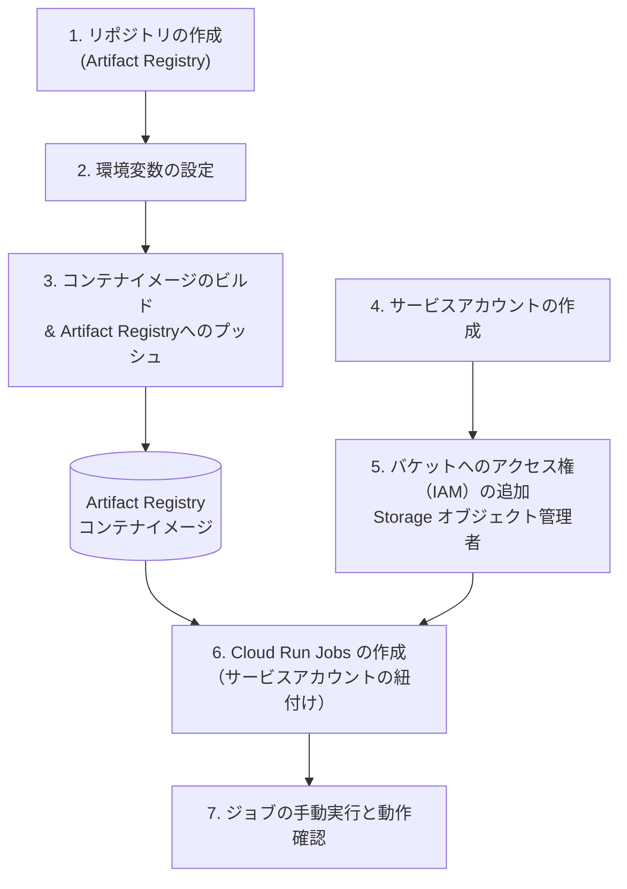

#  (GCP / Cloud Run Jobsの構築手順)

GCP（Google Cloud Platform）上で、電力需給データを自動でフェッチ（抽出: Extract）し、Google Cloud Storage (GCS) に格納するためのETLパイプライン（Eの工程）の構築・実行手順です。

## 📁 プロジェクト構成（概要）

```text
.
├── Dockerfile              # コンテナイメージのビルド定義
├── upload_csv_to_gcs.py    # データ取得およびGCSアップロード処理用Pythonスクリプト
├── config.yaml             # 電力会社の取得先URLおよびGCSバケット名の設定
├── requirements.txt        # Pythonの依存パッケージ一覧
└── .dockerignore           # ビルド対象外のファイル指定（.venv等を除外）
```

---

## 🛠️ 構築・実行手順



### 1. リポジトリの作成(Artifact Registry)
コンテナイメージを格納するための「倉庫」となるリポジトリをGCP上に作成します。

1. Google Cloud コンソールを開き、**Artifact Registry** のページに移動します。
2. 上部にある **[＋ リポジトリを作成]** をクリックします。
3. 以下の設定を入力・選択します：
   * **リポジトリ名:** `etl-repo`
   * **形式:** `Docker`
   * **モード:** `標準 (Standard)`
   * **ロケーションタイプ:** `リージョン` ＞ `asia-northeast1 (東京)` を選択
4. **[作成]** をクリックして完了です。

### 2. 環境変数の設定
作業用ターミナル（PowerShell等）で、プロジェクトで共通して使用する環境変数を定義します。

```powershell

$PROJECT_ID="your-gcp-project-id"    # ご自身のGCPのプロジェクトIDに書き換えてください
$REGION="asia-northeast1"              # デプロイするリージョン（東京は asia-northeast1）
$REPO_NAME="etl-repo"                  # Artifact Registryで作成したDockerリポジトリ名
$IMAGE_NAME="power-csv-fetcher"        # コンテナイメージの名前
$TAG="latest"                          # イメージのタグ（バージョン管理用）
$IMAGE_URI="$REGION-docker.pkg.dev/$PROJECT_ID/$REPO_NAME/$IMAGE_NAME:$TAG" # イメージの完全なパス

```

> **💡 `$TAG="latest"` について**
> * **役割:** `latest` は「最新のバージョン」を指すデフォルトのタグとして広く使われており、タグを省略した際にも自動で参照される標準的な慣習です。
> * **注意点:** 同じタグで何度もビルド・プッシュを繰り返すと古いイメージが上書きされるため、本番運用や厳密なバージョン管理を行いたい場合は、日付やバージョン番号（例: `v1.0.0` など）に書き換えることを推奨します。

### 3. コンテナイメージのビルド & Artifact Registryへのプッシュ
Cloud Buildを使用して、ソースコードとDockerfileからコンテナイメージをビルドし、先ほど作成したArtifact Registryへアップロードします。

```powershell
gcloud builds submit --tag $IMAGE_URI
```

### 4. サービスアカウントの作成
セキュリティ（最小権限の原則）を担保するため、ジョブ専用のサービスアカウントを作成し、必要なGCSバケットにのみ直接権限を付与します。

1. **サービスアカウントの作成**
   * GCPコンソールまたはCLIで、専用のサービスアカウント（例: `power-fetcher-sa`）を作成します。
   * ※この際、プロジェクト全体のIAM権限付与はスキップして問題ありません。

2. **環境変数の設定**
   * 1.で取得した専用サービスアカウントのメールアドレスを環境変数に設定
```powershell
# $PROJECT_IDはご自身のPROJECT_IDに書き換えてください
$SA_EMAIL="power-fetcher-sa@$PROJECT_ID.iam.gserviceaccount.com" 
```
### 5. バケットへのアクセス権（IAM）の追加
1. 保存先GCSバケット（例: `elenmikasa`）の **[権限]** タブを開きます。
2. **[アクセス権を許可]** をクリックし、作成したサービスアカウントのメールアドレス（`$SA_EMAIL`）を指定します。
3. ロールに **「Storage オブジェクト管理者」** を選択して保存します。

### 6. Cloud Run Jobs の作成（サービスアカウントの紐付け）
ビルドしたコンテナイメージと、権限を設定した専用サービスアカウントを紐付けてCloud Run Jobsに登録します。
- `--service-account`：作成した専用のサービスアカウントを指定
- `--task-timeout=300s`：タイムアウトを5分（300秒）に設定
- `--max-retries=2`：失敗時の最大自動リトライ回数を2回に設定

```powershell
gcloud run jobs create power-csv-fetcher-job `
    --image=$IMAGE_URI `
    --region=$REGION `
    --service-account=$SA_EMAIL `
    --task-timeout=300s `
    --max-retries=2
```

### 7. ジョブの手動実行と動作確認
作成したジョブを手動で実行し、データの抽出とGCSへのアップロードを行います。

```powershell
gcloud run jobs execute power-csv-fetcher-job --region=$REGION
```

- **実行結果の確認方法**:
  * コマンドラインまたは GCP コンソール（Cloud Run > ジョブ > 実行）から成否を確認できます。
  * プログラム内の `print()` 出力は、Cloud Run の標準ロギング（Cloud Logging）に自動で収集され、各タスクのログ詳細から確認可能です。